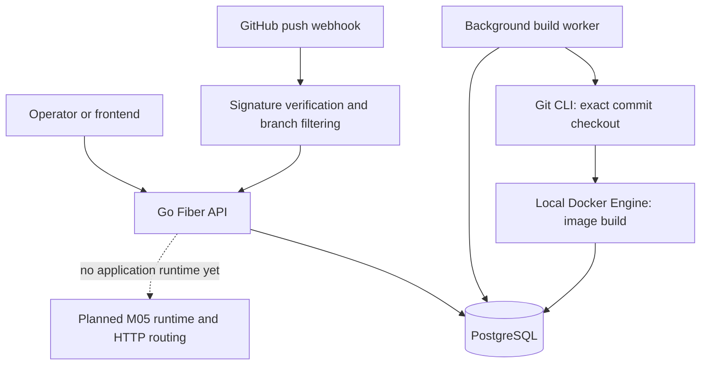

# Architecture

## Status

This page describes the code currently in the repository and separates it from the planned runtime. The current backend is a Go modular monolith with a persistent API, GitHub webhook processing, and a single-host Docker build worker. It does not start application containers or route public application traffic.

## Current Go structure

```text
src/
├── cmd/
│   ├── migrate/
│   └── server/
└── internal/
    ├── applications/        # model, validation, use cases, HTTP handler, repository contract
    ├── deployments/         # lifecycle model, use cases, HTTP handler, repository contract
    ├── builds/              # queue worker and build orchestration
    │   └── local/           # local Git and Docker CLI adapter
    ├── github/              # webhook verification and GitHub REST API client
    ├── bootstrap/           # composition root, routes, worker startup
    └── infrastructure/
        ├── config/
        ├── database/        # GORM adapters, PostgreSQL connection, Goose migrations
        ├── httpx/
        └── logging/
```

The application and deployment packages stay flat: related model, validation, use-case, handler, and contract files are together without creating a directory for each generic layer. Their persistence interfaces do not import GORM. PostgreSQL records and query details live in `infrastructure/database`; `bootstrap` constructs concrete adapters and passes them to use cases. Deployment code consumes an application-reader contract and the application model, not the application database adapter.

HTTP request/response structures exist at the handler boundary. The Fiber handlers currently share the domain package rather than introducing a separate transport package; this keeps the project proportional while allowing use cases to remain independent of Fiber types.

## Implemented components

### Control API

The Fiber server exposes application creation/list/retrieval, deployment creation/retrieval/history, and bounded build-log retrieval under `/api/v1`. It has a `/health` endpoint that reports process-level health; it does not prove PostgreSQL or Docker readiness. The API has no authentication or authorization.

Applications persist a repository URL, configured branch, optional GitHub repository ID, and timestamps. The database schema also has an optional `webhook_secret` column, but current webhook verification uses the server-wide `GITHUB_WEBHOOK_SECRET`; the per-application field is not part of the active request path.

Manual deployment requests may supply a full commit SHA. When omitted, the current GitHub client resolves the GitHub repository's default branch HEAD. GitHub push webhooks instead use the push payload's `after` SHA and filter by the application's configured branch. This means manual and webhook requests currently have different branch selection semantics; decide whether that is intentional before M03 completion.

### GitHub webhook processor

The processor is constructed by `bootstrap` and passed directly to the server; it is not stored in a mutable package global. It verifies the raw request body's HMAC-SHA256 signature, parses push payloads, matches the registered numeric repository ID and configured branch, and creates a queued deployment. It records delivery outcomes in `github_webhook_deliveries`.

The existing delivery insert, deployment create, and outcome update are separate database operations. A process failure can leave a committed `processing` row, and a retry is not yet a complete recovery protocol. Repository `full_name` is not currently compared to the registered URL. Treat webhook idempotency as in progress, not as exactly-once processing.

### Build worker

The server starts a background worker which polls PostgreSQL and claims queued deployments. The repository uses PostgreSQL transaction locking and allows at most one active build across processes sharing the database. The worker checks out the recorded full commit, runs a root-level Dockerfile build with the local Docker CLI, inspects the resulting image ID, bounds persisted logs, and records `built` or `failed`.

The local builder uses a fresh temporary workspace and argument-based Git/Docker commands. It rejects symlinks and special files in the build context and gives subprocesses a 20-minute timeout. These controls improve hygiene and diagnosability; they do not isolate hostile code or enforce CPU, memory, disk, or network quotas.

## Current request/build flow



The frontend is a separate React 19/TypeScript/Vite development application. It calls the API and has no Docker access. There is no Docker Compose definition in the repository yet; local PostgreSQL provisioning is documented as a separate development prerequisite.

## Persistence and lifecycle

PostgreSQL is the source of truth for application registrations, deployment lifecycle state, build image identity, bounded build output, and webhook delivery records. SQL schema changes are versioned Goose migrations embedded in the Go binary.

The deployment lifecycle currently includes:

```text
queued    -> building | cancelled
building  -> built | deploying | failed | cancelled
built     -> deploying | failed | cancelled
deploying -> healthy | failed | cancelled
```

`healthy`, `failed`, and `cancelled` are terminal. Current code reaches `built` or `failed`; deployment runtime transitions remain unused until M05. State changes use validation and conditional persistence rather than accepting arbitrary API updates.

## Dependency boundaries

- Handlers translate Fiber requests and errors into use-case calls and HTTP responses.
- Use cases validate application-level inputs and coordinate contracts.
- Domain models and errors are shared by API, workers, and adapters.
- `infrastructure/database` implements persistence contracts and owns GORM/PostgreSQL details.
- `github` owns signature/payload helpers and GitHub REST calls; it does not own HTTP routes.
- `builds/local` owns OS process, workspace, Git, and Docker CLI behavior.
- `bootstrap` wires adapters and starts the server/worker; it is the only composition root.

Keep new interfaces narrow and add them when they isolate a real boundary or enable meaningful testing. Do not copy domain models to avoid imports or introduce a service locator.

## Security assumptions and failure limits

- The API is unauthenticated; expose it only to trusted operators.
- Webhook secrets and database credentials come from environment configuration and must not enter source control.
- The webhook uses a single configured secret, so all configured GitHub hooks must agree on it.
- The local Docker Engine is privileged relative to the service. Dockerfile instructions are arbitrary repository-controlled code, and Docker is not a strong hostile-tenant security boundary.
- The worker currently enforces a timeout and log cap, but not hard resource limits. A canceled Docker client request does not prove daemon-side work stopped.
- Build logs are repository-controlled and can contain sensitive text. The log endpoint is unauthenticated and must not be exposed outside the trusted operator environment.
- PostgreSQL delivery recording is not yet atomic with deployment creation; delivery retry and crash recovery remain M03 work.
- There is no runtime manager, ingress configuration, health monitoring for deployed apps, high availability, or automated recovery.

The accepted initial build boundary and alternatives are recorded in [ADR 0001](adr/0001-single-host-build-trust-boundary.md). Broader access requires a reviewed isolation model, authentication/authorization, resource quotas, and recovery policy.

## Planned M05 boundary

M05 will add a runtime adapter and an operator-managed HTTP ingress path only after M04's Linux build acceptance. The proposed initial design uses a reserved host-port range bound to loopback and a host-managed reverse proxy; no proxy should receive the Docker socket. It is a proposal in [M05](milestones/M05-deployment-runtime.md), not current behavior.

M10 hardens that initial route with stable application endpoints and route reconciliation; it does not duplicate M05's first runtime or ingress implementation. See [M10](milestones/M10-application-routing-and-readiness.md). Both remain planned, not current behavior.

## Related documentation

- [Roadmap](roadmap.md)
- [Development guide](development.md)
- [Build engine guide](build-engine.md)
- [Technology stack](tech-stack.md)
- [Milestones](milestones/M00-project-definition.md)
