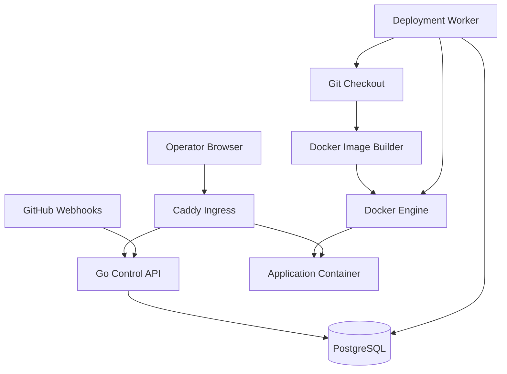

# Architecture

## Status

**Status:** The M02 control API is implemented using module-oriented Clean Architecture boundaries. Deployment execution and later integrations remain planned.

This document distinguishes implemented M02 behavior from the intended later deployment workflow.

## Go Code Structure

The Go module is under `src/`. Its implemented backend structure is:

```text
src/
├── cmd/
│   ├── migrate/
│   └── server/
└── internal/
    ├── applications/
    │   ├── adapters/
    │   │   ├── http/controllers/
    │   │   └── postgres/
    │   ├── domain/
    │   ├── ports/
    │   └── usecase/
    ├── bootstrap/
    ├── deployments/
    │   ├── adapters/
    │   │   ├── http/controllers/
    │   │   └── postgres/
    │   ├── domain/
    │   ├── ports/
    │   └── usecase/
    └── platform/
        ├── config/
        ├── database/
        ├── httpx/
        └── logging/
```

`domain` contains business models, rules, and errors. `usecase` coordinates operations against the small repository contracts in `ports`. HTTP controllers own Fiber request decoding and response mapping; PostgreSQL adapters own GORM persistence and database records. `platform` contains shared technical infrastructure, including the single database connection setup and embedded migrations. `bootstrap` is the composition root: it connects repositories to use cases, controllers, and routes. The command packages remain thin startup entry points.

Dependencies point inward: domain code does not depend on transport or persistence; use cases consume ports; adapters implement or invoke those boundaries; only bootstrap wires concrete adapters. Applications and deployments remain distinct modules. Deployment use cases depend on an application-reader interface that returns the application domain type, not on the application's persistence implementation.

## Architectural Goals

- Deploy Dockerfile-based applications from configured GitHub repositories and branches.
- Build and run applications on one Linux host.
- Persist deployment state and make failures diagnosable.
- Maintain clear component boundaries without premature microservices.
- Keep access to the container engine and workload execution explicit.
- Preserve a path toward stronger isolation in later milestones.

## System Boundary

The initial system consists of a control-plane application, PostgreSQL, Docker Engine, and an HTTP ingress proxy on one Linux host.

GitHub is an external source and webhook provider. Application containers are managed workloads and must not be treated as trusted control-plane components.

The first release targets a single operator or a small trusted environment. It does not promise high availability or safe multi-tenant hosting.

## Components

### 1. Operator Interface

A React and TypeScript web interface.

Responsibilities:
- Register repositories and deployment branches.
- Display project configuration and deployment history.
- Present deployment status and useful failure details.
- Communicate with the control API.

The frontend must never access Docker directly or contain privileged infrastructure credentials.

### 2. Control API

A Go HTTP application that exposes the control-plane API and, in a later milestone, the GitHub webhook endpoint.

Responsibilities:
- Validate and persist application registrations.
- Create durable deployment records.
- Expose project and deployment status.
- In later milestones, verify GitHub webhook signatures and accept valid deployment events.

Webhook handling must validate the event against the configured repository and branch. Duplicate deliveries should not cause uncontrolled duplicate deployments.

### 3. Deployment Worker

A logical component responsible for executing deployment jobs.

Initially, the worker may share the Go codebase with the API while running in a separate process mode.

Responsibilities:
- Claim queued deployment work safely.
- Check out the intended commit.
- Build the container image.
- Start the application container.
- Configure ingress after the application becomes ready.
- Persist state transitions and failure details.
- Handle timeouts, cancellation, and interrupted work.

PostgreSQL is the durable source of truth for deployment state. An in-memory queue alone is insufficient.

### 4. Source Checkout

A narrow adapter around Git operations.

Responsibilities:
- Fetch the configured repository.
- Resolve the intended commit SHA.
- Check out that exact commit into a fresh working directory.
- Apply timeouts and cleanup policies.
- Avoid shell interpolation.
- Prevent workspaces from different deployments from interfering with each other.

Deployments must target an immutable commit, not a branch name that may change during execution.

### 5. Image Builder

A narrow adapter around Docker image builds.

Responsibilities:
- Build from the repository's Dockerfile and build context.
- Assign an identifiable image tag.
- Capture build output and exit status.
- Apply timeouts and cleanup policies.
- Enforce resource limits where supported.

Dockerfiles can execute arbitrary commands. The initial release must only build repositories trusted by the operator.

### 6. Runtime Manager

A narrow adapter around Docker Engine operations.

Responsibilities:
- Start application containers from successfully built images.
- Configure internal networking and required ports.
- Apply restrictive runtime settings and resource limits.
- Track container identifiers and runtime status.
- Stop and remove managed resources when appropriate.

Application containers must not receive the Docker socket or control-plane credentials. Privileged mode and unrestricted host filesystem mounts must not be enabled for user workloads by default.

### 7. HTTP Ingress

Caddy is the proposed HTTP ingress proxy.

Responsibilities:
- Route configured application hostnames to running applications.
- Update routing only after the target application is ready.
- Remove or replace stale routes.
- Provide useful diagnostics for routing failures.

The proxy must not require direct Docker socket access. Route updates should use a controlled configuration mechanism with validation and defined failure behavior.

The first release may require operator-managed DNS. Local development should have a documented hostname setup.

### 8. PostgreSQL

PostgreSQL stores durable control-plane metadata.

Initial records are expected to cover:
- Repository registrations
- Deployment records
- Deployment state and timestamps
- Image and container identifiers
- Failure summaries and references to logs

Schema changes must use versioned migrations. Secrets must not be stored as plaintext metadata, and unbounded build logs should not be stored directly in database records.

### 9. Development Environment

Docker Compose provides the local development dependencies, initially PostgreSQL and the ingress proxy where needed.

Documentation must distinguish these services from the host-level Docker Engine used to build and run application workloads.

## Component Diagram



This diagram shows logical responsibilities, not a mandatory process or container topology. The frontend development server may run separately during development. The production frontend delivery method can be finalized during implementation.

## First End-to-End Deployment Flow

1. The operator registers a GitHub repository and deployment branch.
2. The API validates and stores the registration.
3. GitHub sends a push webhook.
4. The API verifies the signature and checks the configured repository and branch.
5. The API persists a deployment record tied to the event's commit SHA.
6. The worker claims the deployment and marks it as running.
7. The worker checks out the exact commit into a fresh workspace.
8. The image builder builds the Dockerfile and records the image identifier.
9. The runtime manager starts the application container.
10. The application passes its configured readiness check.
11. The ingress configuration is updated to route traffic to the new application.
12. The deployment is marked successful.

If a step fails, the deployment must be marked failed with a useful diagnostic. Where possible, an existing healthy deployment should remain reachable.

Readiness checks, replacement strategy, and rollback behavior must be specified before the deployment workflow is considered complete.

## Deployment State Model

The M02 state model is:

```text
queued    -> building | cancelled
building  -> deploying | failed | cancelled
deploying -> healthy | failed | cancelled
```

`healthy`, `failed`, and `cancelled` are terminal. Failure transitions retain a concise failure message. M02 only creates `queued` deployments; the worker and execution phases are not implemented.

State transitions must be validated. The implementation must account for duplicate webhook deliveries and workers stopping unexpectedly while a deployment is running.

## Data and API Boundaries

- The frontend communicates only with the control API.
- The API owns input validation, authorization, and control-plane persistence.
- The worker owns deployment execution and updates durable state.
- Git, image building, runtime management, and ingress configuration are isolated behind narrow interfaces.
- Workloads cannot access the Docker socket or control-plane secrets.
- Webhook secrets and database credentials come from runtime configuration.
- Build output and application logs may contain sensitive data and require access controls.

## Security Assumptions and Limitations

The single-host design has an important trust boundary: the control plane can operate Docker Engine, while builds execute repository-controlled instructions.

For the MVP:

- Only operator-trusted repositories may be deployed.
- The service must not be presented as safe for arbitrary public users or untrusted tenants.
- The Docker API must not be exposed through an unauthenticated network endpoint.
- The Docker socket must not be mounted into application containers or the ingress proxy.
- Validate webhook signatures and repository, branch, hostname, and configuration inputs.
- Use least privilege, restrictive container settings, resource limits, timeouts, and cleanup.
- Keep secrets out of source control, image layers, logs, and frontend bundles.
- Document that the single host is a single point of failure.

These measures reduce risk but do not make hostile workloads safe. Stronger build isolation and a reviewed threat model are required before broadening the trust model.

## Failure Handling and Observability

Each deployment should record:
- Unique deployment identifier
- Repository and commit SHA
- Creation, start, and completion timestamps
- Current state and phase
- Image and container identifiers when available
- Concise failure reason and a reference to detailed logs

Use structured logs with request and deployment identifiers. Never log credentials, webhook secrets, access tokens, or unfiltered environment variables.

Health endpoints must distinguish process liveness from dependency readiness.

## Quality Attributes

- **Reproducibility:** documented commands and pinned dependency metadata.
- **Durability:** deployment state survives API and worker restarts.
- **Diagnosability:** failures have explicit states and useful logs.
- **Safety:** trusted repositories, controlled Docker access, and restrictive workload defaults.
- **Maintainability:** modular monolith with narrow infrastructure adapters.
- **Operability:** documented single-host setup and recovery limitations.

## Open Decisions for ADRs

1. Backend language and HTTP approach.
2. Frontend tooling and test strategy.
3. PostgreSQL driver and migration tool.
4. Worker job-claiming and recovery strategy.
5. Docker integration and trust model.
6. Ingress proxy and safe route updates.
7. Production frontend delivery.
8. Readiness checks, replacement, and rollback policy.
9. Build-log storage, retention, and access control.

## M01 Boundary

M01 establishes the repository skeleton, configuration, logging, health endpoints, local dependencies, quality checks, CI, and development documentation.

It does not implement the complete deployment workflow, public user onboarding, multi-tenancy, billing, Kubernetes scheduling, or generalized buildpack support.

## M02 Implementation Boundary

The HTTP API is under `/api/v1`. It supports application creation/retrieval, queued deployment creation/retrieval, and paginated deployment history. The database handle is created once during server startup and injected into both PostgreSQL repositories. Schema changes are managed only by Goose migrations; the repositories do not migrate the schema automatically. A forward migration adds the configured branch without changing the already-applied initial migration. Deployment history uses ID as a stable tie-breaker for equal timestamps.

There is intentionally no public status mutation route and no Git checkout, build, or runtime behavior in M02. Internal status transitions are validated in a deployment use case and use a conditional database update so competing transitions cannot both win from the same previous state.

The React frontend in `web/` communicates with the existing API through a small typed client. Vite proxies `/api` to the Go server during development, so no CORS configuration is required. The current API has no application collection or global deployment listing endpoint; the frontend therefore requires a known ID to retrieve records. The API supports manually queuing deployment requests, but not GitHub webhooks, builds, or application runtime management.