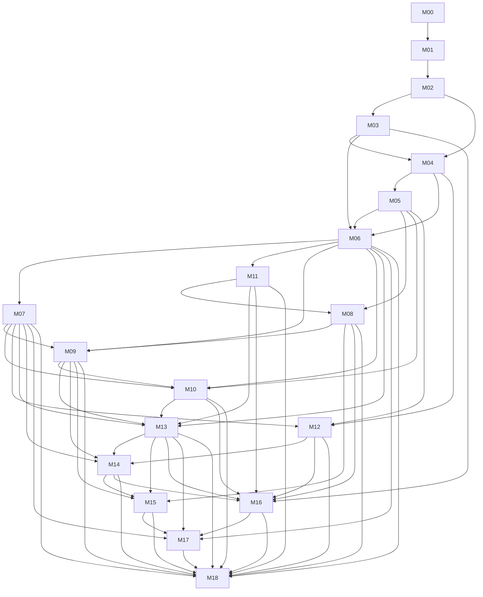

# Roadmap

## Goal and boundaries

Build a coherent, learning-driven Git-to-HTTP deployment system operated by one developer on one Linux host. The initial workflow targets operator-trusted repositories and Dockerfile builds; it is not a production-grade multi-tenant platform. Docker containers are not a strong boundary for malicious builds. Kubernetes, multi-host scheduling, commercial account features, automated HTTPS, and external secret-management services remain out of scope unless requirements materially change.

M00–M05 establish the initial product and first working workflow. M06–M18 extend it through integration, recovery, operator controls, hardening, release, and final acceptance. Milestone documents distinguish current implementation from planned requirements.

## Milestones

| ID | Milestone | Status | Depends on | Outcome |
|---|---|---|---|---|
| M00 | [Project Definition](milestones/M00-project-definition.md) | Partially documented | — | Establish scope, learning goals, and the trusted-repository boundary. |
| M01 | [Development Foundation](milestones/M01-development-foundation.md) | In progress | M00 | Provide reproducible local backend/frontend setup and baseline checks. |
| M02 | [Core API](milestones/M02-core-api.md) | Implementation present; PostgreSQL acceptance pending | M01 | Persist applications, deployment requests, and lifecycle state. |
| M03 | [GitHub Integration](milestones/M03-github-integration.md) | In progress; webhook code exists | M02 | Convert verified, identity-matched GitHub pushes into idempotent deployment requests. |
| M04 | [Build Engine](milestones/M04-build-engine.md) | In progress; worker and local builder exist | M03, M02.2 | Build an immutable requested commit into a recorded local image. |
| M05 | [Deployment Runtime](milestones/M05-deployment-runtime.md) | Planned; runtime not implemented | M04.4 | Start a built image, verify startup readiness, and provide initial HTTP routing while preserving the previous route. |
| M06 | [End-to-End Workflow Integration](milestones/M06-end-to-end-workflow-integration.md) | Planned | M03, M04, M05 | Prove the complete GitHub-to-HTTP path and trace each stage's state and identifiers. |
| M07 | [Durable Workers and Recovery](milestones/M07-durable-workers-and-recovery.md) | Planned | M06 | Recover bounded asynchronous work after crashes without promising exactly-once side effects. |
| M08 | [Runtime Configuration and Secrets](milestones/M08-runtime-configuration-and-secrets.md) | Planned | M05, M11 | Version and protect runtime configuration and encrypted secrets for authorized deployments. |
| M09 | [Deployment Safety and Version Management](milestones/M09-deployment-safety-and-version-management.md) | Planned | M06, M07, M08 | Track current/desired versions, serialize deployment changes, and support explicit rollback. |
| M10 | [Application Routing and Readiness](milestones/M10-application-routing-and-readiness.md) | Planned | M05, M06, M07, M09 | Harden M05 routing with stable endpoints, safe reconciliation, and unavailable-runtime behavior. |
| M11 | [Authentication and Authorization](milestones/M11-authentication-and-authorization.md) | Planned | M06 | Protect administrative operations with a minimal single-operator identity model. |
| M12 | [Resource Limits and Runtime Isolation](milestones/M12-resource-limits-and-runtime-isolation.md) | Planned | M04, M05, M07 | Enforce and verify explicit resource ceilings and restrictive runtime defaults. |
| M13 | [Observability and Diagnostics](milestones/M13-observability-and-diagnostics.md) | Planned | M06, M07, M09, M10, M11 | Correlate requests and worker stages and expose protected, bounded operational signals. |
| M14 | [Retention, Cleanup, and Resource Lifecycle](milestones/M14-retention-cleanup-and-resource-lifecycle.md) | Planned | M07, M09, M12, M13 | Bound database, log, image, and container growth without deleting active or recoverable resources. |
| M15 | [Operational Reliability and Backup/Restore](milestones/M15-operational-reliability-and-backup-restore.md) | Planned | M08, M09, M13, M14 | Demonstrate a protected backup and clean-host restore of state, keys, and application service. |
| M16 | [Security Hardening and Abuse Resistance](milestones/M16-security-hardening-and-abuse-resistance.md) | Planned | M03, M08, M10, M11, M12, M13, M14 | Verify cross-system controls against a prioritized threat model and record residual risks. |
| M17 | [CI/CD and Release Engineering](milestones/M17-ci-cd-and-release-engineering.md) | Planned | M06, M07, M13, M15, M16 | Produce tested, versioned releases and a migration-aware single-host upgrade procedure. |
| M18 | [Final End-to-End Validation and Operational Readiness](milestones/M18-final-end-to-end-validation-and-operational-readiness.md) | Planned | M06–M17 | Validate clean installation, full workflow, failure recovery, security controls, cleanup, and restore. |

## Dependency graph

## Recommended implementation order

Complete M00–M05 in dependency order first. After M06 proves the integrated workflow, M07 and M11 can be developed partly in parallel: one establishes worker recovery, the other protects the control API. M08 requires M11 before secret-management routes are exposed. M12 can proceed after M04/M05 and share worker findings from M07. M09 needs the recovery and configuration contracts; M10 then hardens the initial routing supplied by M05. M13 depends on the workflows and routes it measures. M14 depends on recovery, version retention, resource ownership, and diagnostics. M15 and M16 can overlap after their prerequisites; M17 should incorporate their verified requirements. M18 is a validation milestone and must not become a feature catch-all.

The graph is acyclic. Routing is not duplicated: M05 owns the initial endpoint and readiness behavior; M10 owns stable endpoint mapping and operational reconciliation. M11 is scheduled after the local end-to-end milestone so authentication does not block the first trusted-host learning path, but it is a prerequisite for M08 secret APIs and any broader exposure.

## Completion policy

A milestone is complete only when its acceptance criteria and failure-path tests pass, required migrations/configuration are included, documentation matches the implementation, and residual security risks are explicit. CI/unit tests do not replace Linux, PostgreSQL, or Docker acceptance where those are required.

## Current focus

The immediate work remains verification of M02–M05 and completion of the initial workflow. M06–M18 are future specifications, not implemented product capabilities. The current build boundary is documented in [ADR 0001](adr/0001-single-host-build-trust-boundary.md).
